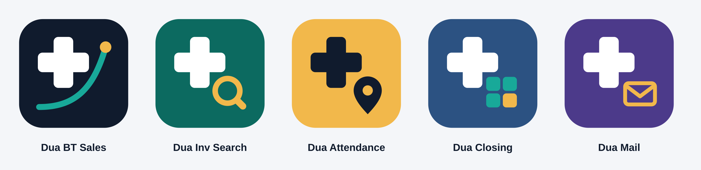

# Bahria Town Sales Intelligence Centre

A pharmacy operations platform for sales, staff, inventory, reporting, closing, attendance and AI-assisted operational insights.

<p align="center">
  <a href="https://bt.duapharma.com"></a>
  
  
  
  
</p>

<p align="center">
  <a href="https://github.com/sysalmanyasin/BT-Sale-Data2/actions/workflows/test.yml"></a>
  
</p>

**BT Sales IC** is a single-pharmacy operations workspace built around the needs of Bahria Town. Its main application is a browser-based Progressive Web App (PWA), supported by Supabase services, a standalone inventory-search PWA and native Android companion applications.

> [!IMPORTANT]
> This repository is designed for one pharmacy and its authorised users. It is not a multi-tenant SaaS product. Some companion applications and integrations have their own data, authentication and operational constraints; read their documentation before deploying or changing them.

| Project information | Details |
|---|---|
| Live application | [bt.duapharma.com](https://bt.duapharma.com) |
| Repository | [sysalmanyasin/BT-Sale-Data2](https://github.com/sysalmanyasin/BT-Sale-Data2) |
| Default branch | `main` |
| Web hosting | GitHub Pages with a custom domain |
| Main backend | Supabase |
| Web application | Static HTML, CSS and JavaScript PWA |
| Native applications | Kotlin-based Android projects |

## Contents

- [Product overview](#product-overview)
- [Applications](#applications)
- [Technology stack](#technology-stack)
- [Architecture](#architecture)
- [Repository layout](#repository-layout)
- [Getting started](#getting-started)
- [Development commands](#development-commands)
- [Testing and continuous integration](#testing-and-continuous-integration)
- [Backend and deployment](#backend-and-deployment)
- [Security and data handling](#security-and-data-handling)
- [Brand identity](#brand-identity)
- [Development guidelines](#development-guidelines)
- [Documentation](#documentation)

## Product overview

The platform brings several pharmacy workflows into one operational environment.

| Area | Main capabilities |
|---|---|
| **Sales** | Daily sales entry, dashboard, historical records, reports, payments, reconciliation and cash-deposit reporting |
| **Management** | Staff Registry, staff notes, targets, ledger, salary, payslips, petty cash, credit, incentives and attendance |
| **Inventory** | Inventory overview, Stock Ledger, excess stock, reorder analysis and inventory-health indicators |
| **STR** | Stock transfer requests and awaited, dispatched and received workflows |
| **Closing** | Closing summaries, shift information and credit-ledger views |
| **Audit** | Audit assignments and read-only integration with the separate Pharmacy Audit Hub |
| **Emergency Billing** | Break-glass billing, cart, held bills, receipts, history and validated refund operations |
| **Documents and Sheets** | Notes, multi-file workbooks and live-data materialisation |
| **Utilities** | Synchronisation, PDF Library, activity log, search, settings and backup tools |
| **Herald** | Rule-based daily operational headlines |
| **BT Intelligence** | AI-assisted analysis, operational findings, forecasts, investigations and the Dua assistant |
| **Inventory Search** | Standalone medicine-reference and inventory-search PWA |

### Repository facts

<!-- repo-facts:start (generated by `npm run readme:sync` — do not edit by hand) -->
| Repository fact | Count |
|---|---|
| JS modules under `js/` | 175 |
| Supabase Edge Functions | 7 |
| Dated SQL migrations | 28 |
| Test files (`*.test.js`) | 120 |
| Android home-screen widgets | 22 |
| GitHub Actions workflows | 5 |
<!-- repo-facts:end -->

These counts are generated from the repository. Run `npm run readme:sync` after structural changes.

## Applications

This repository contains multiple related but independently maintained applications.

### 1. Main web application

The root directory contains the primary PWA.

- Installable on supported desktop and mobile browsers.
- Uses a service worker for app-shell caching and offline resilience.
- Uses Supabase for authentication, database access, synchronisation, storage and server-side functions.
- Includes the main sales, management, inventory, closing, STR, audit and intelligence workflows.

**Entry point:** `index.html`

**Important files:** `manifest.json`, `sw.js`, `build-manifest.json`, `js/` and `css/`.

### 2. Inventory Search PWA

Located in `inventory-search/`.

A separate, lightweight PWA for medicine reference and inventory search, with an AI-assisted chat interface. It has its own application entry point and supporting Supabase Edge Functions.

It is a reference and operational search tool, not a clinical decision-support system.

### 3. Android applications

Each Android application is an independent Gradle project with its own source code and GitHub Actions workflow.

| Application | Directory | Purpose |
|---|---|---|
| **Closing Summary Widgets** | `android-widget/` | 22 home-screen widgets for Android, covering closing, sales, credit and inventory information |
| **BT Attendance** | `android-attendance/` | Staff attendance using geofencing, check-in/check-out events and QR scanning |
| **MailRoutine** | `android-mailroutine/` | Scheduled, template-driven work emails through an authorised Google Workspace/Gmail account |

The Android projects do not share a single Gradle project or application lifecycle.

**MailRoutine highlights**
- Recurring daily and weekly email routines.
- Dynamic template fields and recipient management.
- Local reminders, scheduling and send history.
- Attachments and credential-free backup/restore.
- Optional AI-assisted writing.
- Gmail sending through Google OAuth.

MailRoutine scheduling is device-local and subject to Android background-execution restrictions. It is not a cloud scheduler.

See each application's README for setup, permissions, build instructions, security considerations and limitations.

## Technology stack

| Layer | Technologies |
|---|---|
| Web frontend | HTML, CSS, vanilla JavaScript and ES modules |
| PWA | Web App Manifest, Service Worker and browser storage |
| Backend | Supabase PostgreSQL, Auth, Storage, REST, RPC and Edge Functions |
| AI | Supabase Edge Functions, external model providers, tool-based assistant and pgvector-backed knowledge search |
| Charts and documents | Chart.js, jsPDF, jsPDF-AutoTable, html2canvas and XLSX |
| Android | Kotlin, Android SDK, Gradle, Jetpack Compose, Room and WorkManager where applicable |
| Testing | Node.js built-in test runner, jsdom and ESLint |
| CI/CD | GitHub Actions |

The web application is served as static files. Its release build script updates asset version stamps and service-worker cache metadata; it does not currently produce a bundled/minified production application.

## Architecture

### Main application data flow

The normal business-data flow is:

```text
UI / Page
   ↓
Action
   ↓
Repository
   ↓
State and persistence
   ↓
EventBus
   ↓
UI refresh and dependent modules
```

| Component | Responsibility |
|---|---|
| **Pages and UI** | Render screens and collect user interactions |
| **Actions** | Provide the normal business-data mutation boundary |
| **Repository** | Encapsulate business-data access and persistence |
| **State** | Hold the application's working data |
| **EventBus** | Notify other modules about meaningful changes |
| **Shared modules** | Keep reusable calculations and business rules consistent |

**Important exceptions:** Emergency Billing has a separate cart, local held-bill state and database/RPC transaction path. Some integrations are read-only bridges to external or separately maintained data sources. Do not assume every screen writes through the standard Repository/Actions pipeline.

### BT Intelligence and AI assistant

BT Intelligence is the operational intelligence interface, not a second business-data system.

- Presents operational findings, system status and deeper analysis.
- Includes sales forecasting, inventory insights, audit views and the Forecast Game.
- Uses the existing Dua assistant for conversational investigation.
- Read-only intelligence views do not create a separate write path.
- Assistant changes use the existing tool registry, validation, approval, audit and undo mechanisms.

The AI Center opens the shared Dua assistant; it does not maintain an independent chat or business-data store.

AI output should be treated as assistance, not as an authoritative financial, inventory, medical or operational record. Provider availability and response quality can vary.

For its internal design, see [AI Center architecture](docs/ai-center-architecture.md).

## Repository layout

The following is a high-level map, not an exhaustive file listing.

```text
BT-Sale-Data2/
├── index.html                 # Main PWA entry point
├── manifest.json              # Web app manifest
├── sw.js                      # Service worker and app-shell cache
├── build-manifest.json        # Generated release/build metadata
├── package.json               # Scripts and development dependencies
├── package-lock.json          # Locked npm dependency tree
│
├── js/                        # Main application JavaScript
│   ├── shared/                # Shared business logic and calculations
│   ├── platform/              # Data, authentication and platform services
│   ├── ui/                    # Navigation and shared UI
│   ├── sales/                 # Sales workflows
│   ├── manager/               # Staff and management workflows
│   ├── inventory/             # Inventory workflows
│   ├── str/                   # Stock transfer workflows
│   ├── closing/               # Closing workflows
│   ├── audit/                 # Audit integrations
│   ├── agent/                 # Dua assistant core, tools and UI
│   ├── ai-center/             # BT Intelligence
│   └── herald/                # Deterministic operational headlines
│
├── css/                       # Application styles
├── icons/                     # PWA and application icons
├── inventory-search/          # Standalone Inventory Search PWA
│
├── android-widget/            # Closing Summary Android widgets
├── android-attendance/        # Attendance Android application
├── android-mailroutine/       # MailRoutine Android application
│
├── supabase/
│   ├── config.toml            # Supabase CLI/function configuration
│   ├── functions/             # Edge Functions
│   ├── migrations/            # Dated database migrations
│   ├── audit-project/         # SQL for the separate Audit Hub project
│   ├── pdf_library/           # PDF Library backend documentation
│   └── activity_log/          # Activity-log schema/documentation
│
├── docs/                      # Architecture and project documentation
├── scripts/                   # Build, indexing and maintenance scripts
├── tests/                     # Static, unit, DOM and evaluation tests
└── .github/
    └── workflows/             # Automated tests, deployment and APK builds
```

For a curated map of important modules and their responsibilities, see [docs/module-index.md](docs/module-index.md).

## Getting started

### Requirements

For the main web application:

- Git
- Node.js 22 (the version used by CI)
- npm
- A modern browser

For Android builds:

- JDK 17
- Gradle 8.7
- Android SDK platform 34 and corresponding build tools

The Android projects currently use the Gradle installation supplied by the developer or CI; do not assume a repository Gradle wrapper is available.

### Clone the repository

```bash
git clone https://github.com/sysalmanyasin/BT-Sale-Data2.git
cd BT-Sale-Data2
```

### Install dependencies

```bash
npm ci
```

### Run the web application locally

The application is static and can be served from the repository root:

```bash
npx serve .
```

Alternatively:

```bash
python3 -m http.server 8080
```

Open the local URL shown by the server. Service workers require localhost or HTTPS.

### Local configuration

A complete working environment requires the appropriate Google Sign-In and Supabase configuration, including access to the intended backend projects and database policies.

The automated JavaScript tests do not require live Supabase credentials or a real Google sign-in.

Do not copy production secrets into source files, test fixtures, commits or public documentation. Follow the relevant deployment guide for any required environment configuration.

## Development commands

Run these commands from the repository root unless a command explicitly changes directory.

| Command | Purpose |
|---|---|
| `npm ci` | Install locked dependencies |
| `npm test` | Run the JavaScript test suite |
| `npm run test:verbose` | Run tests with detailed output |
| `npm run test:watch` | Re-run tests while developing |
| `npm run lint` | Run ESLint with zero warnings allowed |
| `npm run build` | Update asset stamps and PWA cache metadata |
| `npm run build:check` | Verify generated build metadata without changing files |
| `npm run bundle:check` | Verify module entry points with esbuild |
| `npm run test:coverage` | Run tests and enforce configured coverage thresholds |
| `npm run eval` | Run the assistant evaluation tests |
| `npm run eval:live` | Run advisory live-model evaluation; requires provider configuration |
| `npm run index:repo` | Rebuild the repository intelligence index |
| `npm run readme:sync` | Regenerate the README repository-facts block |
| `npm run readme:check` | Check that generated README facts are current |

### Before submitting web changes

For changes to shipped application files:

```bash
npm run build
npm run build:check
npm run lint
npm run bundle:check
npm test
```

The build script:
1. Adds content-hash version stamps to local script and stylesheet references in `index.html`.
2. Checks the application-shell content.
3. Updates the service-worker cache version and `build-manifest.json` when shipped assets change.

It does not bundle or minify the web application. Review service-worker cache entries when adding or changing files, especially modules loaded through imports.

## Testing and continuous integration

The repository uses Node's built-in test runner and jsdom for automated JavaScript checks.

The test suite includes:

- Static file-reference, PWA manifest and service-worker checks.
- JavaScript syntax and module-boundary checks.
- Unit tests for shared business calculations and application logic.
- Repository, Actions and EventBus integration tests.
- DOM and navigation tests using the real application markup.
- AI assistant tools, approval, audit, undo and routing tests.
- AI Center and forecast tests.
- Edge Function and secret-leak checks.

The main CI workflow runs linting, build validation, module bundling checks and the coverage-enforced test suite.

### GitHub Actions workflows

| Workflow | Purpose |
|---|---|
| [test.yml](.github/workflows/test.yml) | Main JavaScript quality and test checks |
| [supabase-deploy.yml](.github/workflows/supabase-deploy.yml) | Deploy changed Supabase functions and apply new migrations |
| [build-widget-apk.yml](.github/workflows/build-widget-apk.yml) | Build the Closing Widgets APK |
| [build-attendance-apk.yml](.github/workflows/build-attendance-apk.yml) | Build the Attendance APK |
| [build-mailroutine-apk.yml](.github/workflows/build-mailroutine-apk.yml) | Test and build MailRoutine; optionally create a signed release |

Android workflows are path-scoped to their respective projects. Their debug APKs and other build outputs are uploaded as GitHub Actions artifacts.

Automated tests do not replace real-device or live-service testing. Google authentication, Supabase integration, printers, geofencing, background execution, and actual Gmail sending require their own verification.

See [tests/README.md](tests/README.md) for testing details.

## Android development

Each Android application has its own Gradle configuration and build workflow.

Example — build the Attendance debug APK:

```bash
cd android-attendance
gradle assembleDebug
```

Example — run MailRoutine unit tests and build its debug APK:

```bash
cd android-mailroutine
gradle testDebugUnitTest
gradle assembleDebug
```

The widget application can be built in the same way from `android-widget/`.

For installation, OAuth setup, device permissions, signing and release instructions, use the README inside the relevant Android project. Do not treat a debug APK as a production release.

## Backend and deployment

### Supabase

The repository uses Supabase for database operations, authentication, file storage, RPCs and Edge Functions.

The Edge Functions currently cover these areas:

- `bt-agent` — AI assistant server-side model/provider operations.
- `send-daily-ntfy-briefing` — scheduled operational briefing notifications.
- `closing-ntfy-notify` — closing notifications.
- `set-staff-login` — staff login/PIN management.
- `google-drive` — Google Drive backup operations.
- `inventory-chat` — inventory-context chat.
- `medicine-ai-info` — medicine reference information.

Deployment instructions are maintained beside the relevant function in its `DEPLOY.md`.

### Database migrations

Database changes belong in dated SQL files under `supabase/migrations/`.

The Supabase deployment workflow:
- Runs checks before deployment.
- Detects changed functions and new migration files.
- Applies the selected migrations before deploying changed functions.
- Supports manual workflow dispatch.

Configure the required GitHub Actions secrets described in [supabase-deploy.yml](.github/workflows/supabase-deploy.yml) before relying on automated deployment. Provider API keys belong in Supabase secrets, not in the repository.

The SQL under `supabase/audit-project/` is intended for the separate Pharmacy Audit Hub project. It is not part of the main project's migration directory and must be applied to the correct project.

### Web deployment

The main PWA is hosted through GitHub Pages using the repository's custom domain configuration. Changes to the shipped web app should include the generated asset/cache updates described above.

Check the latest GitHub Actions run and the live application after deployment rather than relying on historical version numbers in documentation.

## Security and data handling

This application handles sensitive pharmacy, financial, staff and operational information. Security must be considered at the database, server, browser and Android layers.

- Never commit service-role keys, private API keys, OAuth client secrets, database passwords, signing credentials or privileged tokens.
- Public client keys are not secrets. Their safety depends on correct Row Level Security (RLS), server-side validation and restricted database permissions.
- Do not treat a client-side screen, PIN prompt or hidden UI control as a backend security boundary.
- Validate sensitive writes and financial operations at the database/RPC or trusted server layer.
- Keep AI provider credentials server-side wherever the integration supports it.
- Redact sensitive information before sending content to external AI services.
- Treat email, documents, imported data and AI-generated content as untrusted input.
- Never log access tokens, credentials, private message bodies or unnecessary personal information.
- Keep Android release signing material in protected CI secrets, never in source control.

**Important operational distinction:** the companion applications do not all have identical authentication or data-access models. Attendance, widgets, Emergency Billing, MailRoutine and the main PWA must be reviewed independently. Consult their current application documentation and database migrations before changing permissions or deploying a release.

If a credential is exposed, treat it as compromised and rotate or revoke it.

## Brand identity

**DuaPharma** is the parent brand; **BT Pharmacy Operations** is the platform and **BT Intelligence** the AI layer. Product names, package IDs and application IDs are unchanged. Tagline: *Technology for better pharmacy operations.*

| Colour | Hex | Use |
| --- | --- | --- |
| Primary Navy | `#101B2D` | Headers, launcher-icon field, dark surfaces, `theme-color` |
| Intelligence Teal | `#18A999` | Logo line, highlights, glows. Not for white text (2.9:1) |
| Teal, AA-safe | `#0E8074` (light) / `#14998B` (dark) | `--accent`: buttons, links, focus |
| Insight Amber | `#F2B84B` | Logo endpoint, nav underline end, aggregate highlights |
| Slate | `#465166` | Secondary text |
| White | `#FFFFFF` | Logo cross, text on navy |

### Icon family

All five apps carry the DuaPharma pharmacy cross in the same position and size. Each app gets its own background colour and one corner glyph, so they stay recognisable as one family but are easy to tell apart on a home screen. App labels share the `Dua` prefix; package names and application IDs are unchanged.

| App | Label | Background | Glyph |
| --- | --- | --- | --- |
| Main PWA (`icons/`) | Dua BT Sales | Primary Navy | Rising line + amber point (the original logo) |
| Inventory Search (`inventory-search/icons/`) | Dua Inv Search | Deep teal `#0C6A60` | Magnifier |
| `android-attendance/` | Dua Attendance | Insight Amber (navy cross) | Location pin |
| `android-widget/` | Dua Closing | Info blue `#2C5282` | 2×2 widget tiles |
| `android-mailroutine/` | Dua Mail | Violet `#4C3A8A` | Envelope |



`scripts/build-brand.mjs` generates everything except the main PWA's hand-exported masters: the Inventory Search SVG and PNG set, the Android adaptive foreground, themed monochrome and legacy layers, the launcher background colours, and the `duapharma-wordmark-*.svg` files (the wordmark is converted to outlines, so it needs no font). Change a glyph or colour there, then run `npm run brand` (text outputs) and `npm run brand:png` (PNGs; needs `npm i --no-save sharp`). `npm run brand:check` and `tests/static/brand-icons.test.js` fail if a generated file is stale or two apps share a launcher layer. Use `icons/duapharma-wordmark-dark.svg` on navy and `-light.svg` on white.

The original logo is a geometric pharmacy cross with a rising data curve ending in an amber point. `icons/icon.svg` is the master; the PNG sizes, maskable icons, monochrome mark and watermarks in `icons/` are exported from the same geometry. The Android apps carry the same mark as vector adaptive icons (with a themed monochrome layer) and a monochrome `ic_stat_duapharma` notification icon.

Semantic colours (success, warning, error, inventory status, MailRoutine "sending") are intentionally not brand colours. Inventory "excess" uses `--info`, the old blue, so it stays distinct from the teal accent. Changing shipped icons or CSS needs `npm run build` so the service-worker cache version moves.

## Development guidelines

1. Read the relevant implementation and tests before changing a feature.
2. Prefer existing shared business calculations over duplicate formulas.
3. Keep new business-data writes within the established Actions/Repository architecture unless the feature has a documented separate transaction path.
4. Keep EventBus events and cross-module contracts stable.
5. Use ES modules for new JavaScript code and avoid introducing new global dependencies.
6. Preserve service-worker app-shell coverage and run the build checks after changing shipped assets.
7. Add dated SQL migrations for database changes; do not silently edit deployed schema assumptions.
8. Validate financial, inventory and refund operations at the trusted backend boundary.
9. Add or update automated tests for changed behaviour.
10. Test Android permissions, background behaviour, printing and integrations on real devices where applicable.
11. Keep credentials and sensitive operational data out of commits, logs and AI prompts.
12. Update the relevant focused documentation when a feature's behaviour or setup changes.

**Order of truth:** running implementation and deployed database policies take precedence over descriptive documentation. Tests and focused application guides should be consulted before relying on a README statement.

## Documentation

Use these documents for deeper, feature-specific information:

| Document | What it covers |
|---|---|
| [Module Index](docs/module-index.md) | Important JavaScript modules, responsibilities and conventions |
| [AI Center Architecture](docs/ai-center-architecture.md) | BT Intelligence design, data sources, assistant integration and security model |
| [Structure Roadmap](docs/structure-roadmap.md) | Architecture improvements and remaining refactoring work |
| [Testing Guide](tests/README.md) | Test structure, execution and coverage boundaries |
| [Closing Widgets](android-widget/README.md) | Widget features, setup and build instructions |
| [BT Attendance](android-attendance/README.md) | Attendance installation, device setup and limitations |
| [MailRoutine](android-mailroutine/README.md) | Email routines, Gmail OAuth, scheduling, backup and release process |
| [Supabase Functions](supabase/functions/) | Function-specific implementation and deployment guides |

---

**Project principle:** maintain reliable pharmacy operations, protect data integrity, keep business calculations consistent, and use automation and AI as controlled assistance—not as substitutes for verified records or human accountability.
