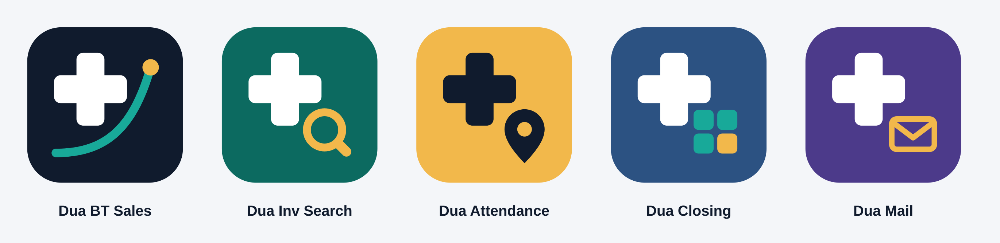

# Bahria Town Sales Intelligence Centre

A pharmacy operations platform for sales, staff, inventory, reporting, closing, attendance and AI-assisted operational insights.

<p align="center">
  <a href="https://bt.duapharma.com"></a>
  
  
  
  
</p>

<p align="center">
  <a href="https://github.com/sysalmanyasin/BT-Sale-Data2/actions/workflows/test.yml"></a>
  
</p>

**BT Sales IC** is a single-pharmacy operations workspace built around the needs of Bahria Town. Its main application is a browser-based Progressive Web App (PWA), supported by Supabase services, a standalone inventory-search PWA and native Android companion applications.

> [!IMPORTANT]
> This repository is designed for one pharmacy and its authorised users. It is not a multi-tenant SaaS product. Some companion applications and integrations have their own data, authentication and operational constraints; read their documentation before deploying or changing them.

| Project information | Details |
|---|---|
| Live application | [bt.duapharma.com](https://bt.duapharma.com) |
| Repository | [sysalmanyasin/BT-Sale-Data2](https://github.com/sysalmanyasin/BT-Sale-Data2) |
| Default branch | `main` |
| Web hosting | GitHub Pages with a custom domain |
| Main backend | Supabase |
| Web application | Static HTML, CSS and JavaScript PWA (no production bundle) |
| Release notes | [CHANGELOG.md](CHANGELOG.md); the live service-worker cache version is in `sw.js` and `build-manifest.json` |
| Native applications | Kotlin-based Android projects |

## Contents

- [Product overview](#product-overview)
- [Applications](#applications)
- [Technology stack](#technology-stack)
- [Architecture](#architecture)
- [Repository layout](#repository-layout)
- [Getting started](#getting-started)
- [Development commands](#development-commands)
- [Testing and continuous integration](#testing-and-continuous-integration)
- [Backend and deployment](#backend-and-deployment)
- [Security and data handling](#security-and-data-handling)
- [Known limitations](#known-limitations)
- [Brand identity](#brand-identity)
- [Development guidelines](#development-guidelines)
- [Documentation](#documentation)

## Product overview

The platform brings several pharmacy workflows into one operational environment.

| Area | Main capabilities |
|---|---|
| **Cover** | Operational hub with a Summary / Detailed view, section tiles, cross-domain signals and Herald headlines |
| **Sales** | Daily sales entry, dashboard, historical records, reports, payments, reconciliation, cash-deposit reporting and the Daily Check List |
| **Management** | Staff Registry, staff notes, targets, ledger, salary, payslips, petty cash, credit, incentives and attendance |
| **Inventory** | Inventory overview, Stock Ledger, excess stock, reorder analysis and inventory-health indicators |
| **STR** | Stock transfer requests and awaited, dispatched and received workflows |
| **Closing** | Closing summaries, shift information and credit-ledger views |
| **Audit** | Audit assignments and read-only integration with the separate Pharmacy Audit Hub |
| **Emergency Billing** | Break-glass billing, cart, held bills, receipts, history and validated refund operations |
| **Documents and Sheets** | Notes, multi-file workbooks and live-data materialisation |
| **Utilities** | Sync Center, PDF Library, activity log, global search, read-only Gmail briefing, Send via Gmail, settings and Google Drive backup |
| **Herald** | Rule-based daily operational headlines |
| **BT Intelligence** | AI-assisted analysis, operational findings, forecasts, investigations and the Dua assistant |
| **Inventory Search** | Standalone medicine-reference and inventory-search PWA |

### Repository facts

<!-- repo-facts:start (generated by `npm run readme:sync` — do not edit by hand) -->
| Repository fact | Count |
|---|---|
| JS modules under `js/` | 194 |
| Supabase Edge Functions | 7 |
| Dated SQL migrations | 28 |
| Test files (`*.test.js`) | 121 |
| Android home-screen widgets | 22 |
| GitHub Actions workflows | 5 |
<!-- repo-facts:end -->

These counts are generated from the repository. Run `npm run readme:sync` after structural changes.

## Applications

This repository contains multiple related but independently maintained applications.

### 1. Main web application

The root directory contains the primary PWA.

- Installable on supported desktop and mobile browsers.
- Uses a service worker for app-shell caching and offline resilience.
- Uses Supabase for authentication, database access, synchronisation, storage and server-side functions.
- Includes the main sales, management, inventory, closing, STR, audit and intelligence workflows.
- Works as a single-device-active workspace: Sync Center coordinates devices, and credit and ledger data merge entry by entry with delete tombstones rather than last-write-wins.

**Entry point:** `index.html`

**Important files:** `manifest.json`, `sw.js`, `build-manifest.json`, `CHANGELOG.md`, `js/` and `css/`.

### 2. Inventory Search PWA

Located in `inventory-search/`.

A separate, lightweight PWA for medicine reference and inventory search, with an AI-assisted chat interface. It has its own entry point, service worker (`inv-search-shell-*` cache) and icon set, and uses the public `inventory-chat` and `medicine-ai-info` Edge Functions (no sign-in step).

It is a reference and operational search tool, not a clinical decision-support system.

### 3. Android applications

Each Android application is an independent Gradle project with its own source code and GitHub Actions workflow.

| Application | Directory | Purpose |
|---|---|---|
| **Dua Closing** (Closing Summary Widgets) | `android-widget/` | 22 home-screen widgets covering closing, sales, credit, inventory and STR information; mirrors key web calculations so it works without the PWA open |
| **Dua Attendance** (BT Attendance) | `android-attendance/` | Staff attendance using geofencing, check-in/check-out events, QR fallback, offline queue and manager notifications |
| **Dua Mail** (MailRoutine) | `android-mailroutine/` | Scheduled, template-driven work emails through an authorised Google Workspace/Gmail account, with two home-screen widgets |

The Android projects do not share a single Gradle project or application lifecycle. The former Trusted Web Activity wrapper (`android-app/`) has been removed.

**MailRoutine highlights**
- Recurring daily and weekly email routines.
- Dynamic template fields and recipient management.
- Local reminders, scheduling and send history.
- Home-screen widgets: *Next up* and *Upcoming emails*.
- Attachments and credential-free backup/restore.
- Optional AI-assisted writing (Groq or Anthropic; off until an API key is added).
- Gmail sending through Google OAuth.

MailRoutine scheduling is device-local and subject to Android background-execution restrictions. It is not a cloud scheduler.

See each application's README for setup, permissions, build instructions, security considerations and limitations.

## Technology stack

| Layer | Technologies |
|---|---|
| Web frontend | HTML, CSS, vanilla JavaScript and ES modules |
| PWA | Web App Manifest, Service Worker and browser storage |
| Backend | Supabase PostgreSQL, Auth, Storage, REST, RPC and Edge Functions |
| AI | `bt-agent` Edge Function over a fail-over pool of external providers (Groq, Cerebras, Gemini, OpenRouter), a browser-driven tool loop, pgvector-backed knowledge search and the browser's Web Speech API for voice |
| Charts and documents | Chart.js, jsPDF, jsPDF-AutoTable, html2canvas and XLSX |
| Android | Kotlin, Android SDK, Gradle, Jetpack Compose, Room and WorkManager where applicable |
| Quality | Node.js built-in test runner, jsdom, ESLint (`no-undef` as an error, zero warnings), c8 coverage floor and an esbuild bundle check |
| CI/CD | GitHub Actions |

The web application is served as static files straight from the repository root. Its release build script updates content-hash asset stamps and service-worker cache metadata. **esbuild is used only to verify that every module entry resolves** (`npm run bundle:check`); no bundled or minified production build is shipped yet, so the app still relies on script load order.

## Architecture

### Main application data flow

The normal business-data flow is:

```text
UI / Page
   ↓
Action
   ↓
Repository
   ↓
State and persistence
   ↓
EventBus
   ↓
UI refresh and dependent modules
```

| Component | Responsibility |
|---|---|
| **Pages and UI** | Render screens and collect user interactions |
| **Actions** | Provide the normal business-data mutation boundary |
| **Repository** | Encapsulate business-data access and persistence |
| **State** | Hold the application's working data |
| **EventBus** | Notify other modules about meaningful changes |
| **Shared modules** | Keep reusable calculations and business rules consistent |

### Code layers inside `js/`

- **Core layer:** `platform/` (state, sync, auth, boot), `ui/` (shell, navigation, search) and `lib/` (date, format, print, rules, Gmail send, PDF library).
- **Domain folders:** `sales/`, `manager/`, `inventory/`, `str/`, `closing/`, `audit/`, `emergency-billing/`, `ledger/`, `sheets/`, `mail/`, `cover/`, `herald/`, plus `agent/` and `ai-center/`.
- **`shared/`:** pure, reusable calculations and business rules. A domain may import only `shared/`, the core layer and its own folder; `tests/static/domain-boundaries.test.js` enforces this, and `scripts/move-module.mjs` moves modules and rewrites references.
- **Delegated DOM actions:** there are no inline `on*=` handlers. `js/shared/dom-actions.js` dispatches `data-on-click` style attributes, and `tests/static/no-inline-handlers.test.js` keeps the count at zero.
- **Legacy globals:** `no-undef` is an ESLint error. The names the app still reads as implicit globals are listed in `config/legacy-globals.mjs`, a registry that may only shrink (ratcheted by `tests/static/legacy-globals.test.js`).
- **Script CSP:** `index.html` carries a `script-src` policy and has no inline scripts; `tests/static/csp-and-cors.test.js` keeps allowed script hosts consistent.
- **One backend config:** Supabase URLs and public keys come from `js/shared/backend-config.js` only.

**Important exceptions:** Emergency Billing has a separate cart, local held-bill state and database/RPC transaction path. Some integrations are read-only bridges to external or separately maintained data sources. Do not assume every screen writes through the standard Repository/Actions pipeline.

### BT Intelligence and AI assistant

BT Intelligence (`#ai-center`) is the operational intelligence interface, not a second business-data system. It owns no business logic, no data layer and no write path.

- Command Deck tabs: Overview, Sales & Forecast, Inventory, Operations, Audit and More.
- Includes weekday forecasting, inventory and STR insights, Audit & Variance, Near Expiry, Payments, agent health and activity, and the on-device **AI Forecast Game**.
- **Dua**, the single shared assistant, is available on every page from the floating *Ask Dua* button; BT Intelligence has no chat of its own.
- A missing data source is shown as unknown, never as an invented value.

**Assistant safety model**

- **Deterministic first.** Dashboard, Herald and the briefing alerts are rule-based and AI-free. The assistant never computes figures itself; it calls read-only tools that use the app's own calculators.
- **Changes are locked by default** (device-local lock). Once unlocked, every change is an approval-gated proposal written only through `Actions` / `LedgerActions`, audited (`agent_audit`) and undoable, including after a reload.
- **Gate in code, not in the prompt.** `tool-registry.runTool` refuses to run a `write` or `critical` tool when locked, unapproved or rejected. `BTAgent.decide()` refuses approvals that are not a trusted user gesture, so scripts and voice cannot approve.
- **Deletes** need the user to type `DELETE`, and the model must name the exact record it read first.
- **Hard blocks** (`js/agent/core/hard-blocks.js`) cover salary finalisation, refunds and bulk deletes. A server-side **kill switch** disables the assistant on all devices.
- **Auditor and quotas.** `core/auditor.js` adds warnings for repeated or large changes; provider usage is rate-limited server-side.
- **Provider routing.** `bt-agent` requires a signed-in session **and** an active `bt_authorized_users` row. Salary, credit, staff and email content is never sent to providers that may train on free-tier prompts, and arguments are redacted before storage.
- **Voice** uses the browser's Web Speech API; nothing is recorded by the app.
- **Evaluation:** `tests/eval/` holds routing, tool-offering and golden-answer cases, and requires every registered tool to appear in at least one case. It runs inside `npm test`, which also gates the Supabase deploy.

AI output is assistance, not an authoritative financial, inventory, medical or operational record. Provider availability and quality vary.

**Definitions used across the app:** the official daily sale is `TOTAL`; `COMP SALE` is a comparison figure and `DIFF = TOTAL − COMP SALE`. The dashboard, targets, daily push briefing and assistant all use `TOTAL`.

For internals, see [AI Center architecture](docs/ai-center-architecture.md), [KPI verification](docs/ai-center-kpi-verification.md), [final report](docs/ai-center-final-report.md) and [Manager Intelligence status](README-manager-intelligence.md).

## Repository layout

The following is a high-level map, not an exhaustive file listing.

```text
BT-Sale-Data2/
├── index.html                 # Main PWA entry point
├── manifest.json              # Web app manifest
├── sw.js                      # Service worker and app-shell cache
├── build-manifest.json        # Generated release/build metadata
├── CHANGELOG.md               # Release notes (moved out of sw.js)
├── eslint.config.js           # Lint rules (no-undef is an error)
├── package.json               # Scripts and development dependencies
│
├── js/                        # Main application JavaScript (see docs/module-index.md)
│   ├── platform/ ui/ lib/     # Core layer: state, sync, auth, shell, navigation, utilities
│   ├── shared/                # Shared business calculations and rules
│   ├── sales/                 # Dashboard, entry, reports, payments, Daily Check List
│   ├── manager/               # Staff Registry, salary, targets, attendance
│   ├── ledger/                # Ledger, Petty Cash, Jazz Cash
│   ├── inventory/ str/        # Inventory analytics and STR workflows
│   ├── closing/ audit/        # Closing and Audit Hub bridges
│   ├── emergency-billing/     # Break-glass billing
│   ├── sheets/                # Notes and workbooks
│   ├── mail/                  # Gmail briefing and Cover mail strip
│   ├── cover/ herald/         # Cover hub and daily headlines
│   ├── agent/                 # Dua assistant: core/, tools/, ui/
│   └── ai-center/             # BT Intelligence
│
├── css/                       # Per-domain stylesheets
├── icons/                     # Main PWA icons and DuaPharma wordmarks
├── config/                    # legacy-globals.mjs (shrink-only registry)
├── inventory-search/          # Standalone Inventory Search PWA
│
├── android-widget/            # Dua Closing: 22 home-screen widgets
├── android-attendance/        # Dua Attendance
├── android-mailroutine/       # Dua Mail (MailRoutine)
│
├── supabase/
│   ├── config.toml            # Per-function JWT settings
│   ├── functions/             # Edge Functions (each with DEPLOY.md)
│   ├── migrations/            # Dated database migrations
│   ├── audit-project/         # SQL for the separate Audit Hub project
│   ├── pdf_library/           # PDF Library backend notes
│   └── activity_log/          # Activity-log schema
│
├── docs/                      # Architecture, roadmap, brand and module docs
├── scripts/                   # build, brand, bundle-check, readme-facts, repo index
├── tests/                     # static/, unit/, dom/, eval/, helpers/
└── .github/workflows/         # test, supabase-deploy and three APK builds
```

For a curated map of important modules and their responsibilities, see [docs/module-index.md](docs/module-index.md).

## Getting started

### Requirements

For the main web application:

- Git
- Node.js 22 (the version used by CI)
- npm
- A modern browser

For Android builds:

- JDK 17
- Gradle 8.7
- Android SDK platform 34 and corresponding build tools

The Android projects currently use the Gradle installation supplied by the developer or CI; do not assume a repository Gradle wrapper is available.

### Clone the repository

```bash
git clone https://github.com/sysalmanyasin/BT-Sale-Data2.git
cd BT-Sale-Data2
```

### Install dependencies

```bash
npm ci
```

### Run the web application locally

The application is static and can be served from the repository root:

```bash
npx serve .
```

Alternatively:

```bash
python3 -m http.server 8080
```

Open the local URL shown by the server. Service workers require localhost or HTTPS.

### Local configuration

A complete working environment requires the appropriate Google Sign-In and Supabase configuration, including access to the intended backend projects and database policies.

The automated JavaScript tests do not require live Supabase credentials or a real Google sign-in.

Do not copy production secrets into source files, test fixtures, commits or public documentation. Follow the relevant deployment guide for any required environment configuration.

## Development commands

Run these commands from the repository root unless a command explicitly changes directory.

| Command | Purpose |
|---|---|
| `npm ci` | Install locked dependencies |
| `npm test` | Run the JavaScript test suite |
| `npm run test:verbose` | Run tests with detailed output |
| `npm run test:watch` | Re-run tests while developing |
| `npm run lint` | Run ESLint with zero warnings allowed |
| `npm run build` | Update asset stamps and PWA cache metadata |
| `npm run build:check` | Verify generated build metadata without changing files |
| `npm run bundle:check` | Verify module entry points with esbuild |
| `npm run test:coverage` | Run tests and enforce configured coverage thresholds |
| `npm run eval` | Run the assistant evaluation tests |
| `npm run eval:live` | Run advisory live-model evaluation; requires provider configuration |
| `npm run index:repo` | Rebuild the repository intelligence index |
| `npm run brand` / `brand:check` / `brand:png` | Regenerate or verify generated brand assets (`brand:png` needs `sharp`) |
| `npm run readme:sync` | Regenerate the README repository-facts block |
| `npm run readme:check` | Check that generated README facts are current |

### Before submitting web changes

For changes to shipped application files:

```bash
npm run build
npm run build:check
npm run lint
npm run bundle:check
npm run test:coverage   # or npm test
```

CI (`test.yml`, Node 22) runs `lint`, `build:check`, `bundle:check` and `test:coverage` (floor: 68% lines, 72% branches, 65% functions). Release notes go in `CHANGELOG.md`, not in `sw.js`; `npm run build` only bumps the cache number.

The build script:
1. Adds content-hash version stamps to local script and stylesheet references in `index.html`.
2. Checks the application-shell content.
3. Updates the service-worker cache version and `build-manifest.json` when shipped assets change.

It does not bundle or minify the web application. Review service-worker cache entries when adding or changing files, especially modules loaded through imports.

## Testing and continuous integration

The repository uses Node's built-in test runner and jsdom for automated JavaScript checks.

The test suite includes:

- Static file-reference, PWA manifest and service-worker checks.
- JavaScript syntax and module-boundary checks.
- Unit tests for shared business calculations and application logic.
- Repository, Actions and EventBus integration tests.
- DOM and navigation tests using the real application markup.
- AI assistant tools, approval, audit, undo and routing tests.
- AI Center and forecast tests.
- Edge Function and secret-leak checks.

The main CI workflow runs linting, build validation, module bundling checks and the coverage-enforced test suite. Tests also guard architecture rules: domain boundaries, no inline handlers, legacy-global ratchet, CSP/CORS, file-size budgets, brand-icon consistency and README facts.

### GitHub Actions workflows

| Workflow | Purpose |
|---|---|
| [test.yml](.github/workflows/test.yml) | Main JavaScript quality and test checks |
| [supabase-deploy.yml](.github/workflows/supabase-deploy.yml) | Deploy changed Supabase functions and apply new migrations |
| [build-widget-apk.yml](.github/workflows/build-widget-apk.yml) | Build the Closing Widgets APK |
| [build-attendance-apk.yml](.github/workflows/build-attendance-apk.yml) | Build the Attendance APK |
| [build-mailroutine-apk.yml](.github/workflows/build-mailroutine-apk.yml) | Test and build MailRoutine; optionally create a signed release |

Android workflows are path-scoped to their respective projects. Their debug APKs and other build outputs are uploaded as GitHub Actions artifacts.

Automated tests do not replace real-device or live-service testing. Google authentication, Supabase integration, printers, geofencing, background execution, and actual Gmail sending require their own verification.

See [tests/README.md](tests/README.md) for testing details.

## Android development

Each Android application has its own Gradle configuration and build workflow.

Example — build the Attendance debug APK:

```bash
cd android-attendance
gradle assembleDebug
```

Example — run MailRoutine unit tests and build its debug APK:

```bash
cd android-mailroutine
gradle testDebugUnitTest
gradle assembleDebug
```

The widget application can be built in the same way from `android-widget/`.

For installation, OAuth setup, device permissions, signing and release instructions, use the README inside the relevant Android project. Do not treat a debug APK as a production release.

## Backend and deployment

### Supabase

The repository uses Supabase for database operations, authentication, file storage, RPCs and Edge Functions.

The Edge Functions currently cover these areas:

- `bt-agent` — AI assistant server-side model/provider operations.
- `send-daily-ntfy-briefing` — scheduled operational briefing notifications.
- `closing-ntfy-notify` — closing notifications.
- `set-staff-login` — staff login/PIN management.
- `google-drive` — Google Drive backup operations.
- `inventory-chat` — inventory-context chat.
- `medicine-ai-info` — medicine reference information.

`verify_jwt` is pinned per function in `supabase/config.toml`. `set-staff-login`, `medicine-ai-info` and `google-drive` allow only `https://bt.duapharma.com` as origin by default (`ALLOWED_ORIGINS` overrides); `bt-agent` uses `AGENT_ALLOWED_ORIGINS`. Deployment instructions are maintained beside each function in its `DEPLOY.md`.

### Database migrations

Database changes belong in dated SQL files under `supabase/migrations/`.

The Supabase deployment workflow:
- Runs checks before deployment.
- Detects changed functions and new migration files.
- Applies the selected migrations before deploying changed functions.
- Supports manual workflow dispatch.

Configure the required GitHub Actions secrets described in [supabase-deploy.yml](.github/workflows/supabase-deploy.yml) before relying on automated deployment. Provider API keys belong in Supabase secrets, not in the repository.

The SQL under `supabase/audit-project/` is intended for the separate Pharmacy Audit Hub project. It is not part of the main project's migration directory and must be applied to the correct project.

### Web deployment

The main PWA is hosted through GitHub Pages using the repository's custom domain configuration. Changes to the shipped web app should include the generated asset/cache updates described above.

Check the latest GitHub Actions run and the live application after deployment rather than relying on historical version numbers in documentation.

## Security and data handling

This application handles sensitive pharmacy, financial, staff and operational information. Security must be considered at the database, server, browser and Android layers.

- Never commit service-role keys, private API keys, OAuth client secrets, database passwords, signing credentials or privileged tokens.
- Public client keys are not secrets. Their safety depends on correct Row Level Security (RLS), server-side validation and restricted database permissions.
- Do not treat a client-side screen, PIN prompt or hidden UI control as a backend security boundary.
- Validate sensitive writes and financial operations at the database/RPC or trusted server layer.
- Keep AI provider credentials server-side wherever the integration supports it.
- Redact sensitive information before sending content to external AI services.
- Treat email, documents, imported data and AI-generated content as untrusted input.
- Never log access tokens, credentials, private message bodies or unnecessary personal information.
- Keep Android release signing material in protected CI secrets, never in source control.

**Current database posture (from the migrations; verify against the live project):**

- A helper, `bt_is_authorized_user()`, checks that the caller's JWT email is an **active** row in `bt_authorized_users`. It exists because `signInWithIdToken` accepts any Google account, so "authenticated" alone does not mean "one of our people".
- **Emergency Billing** is locked down: the public key can no longer read or write its tables or call its RPCs; only allow-listed users can, through wrapper RPCs that check authorisation first (`20261024120000`, `20261024130000`).
- **Security hardening batches 1 and 2** (`20261024150000`, `20261024160000`): widget summary functions require an allow-listed user or the widget service account; `TRUNCATE`/`REFERENCES`/`TRIGGER` were removed from client roles; legacy open `bt_sessions` policies were dropped; attendance manager-PIN verification locks after repeated failures; attendance location writes need an allow-listed user; the `pdf-library` bucket is private and served through short-lived signed URLs.
- Edge Functions that stay public (`inventory-chat`, `medicine-ai-info`, the ntfy functions) either hold no private data or authenticate with a shared secret header.
- This repository is public. The ntfy topic names and secrets live only in Supabase, and `tests/static/ntfy-functions.test.js` scans `supabase/functions/` for leaks.

**Important operational distinction:** the companion applications do not all have identical authentication or data-access models. Attendance, widgets, Emergency Billing, MailRoutine and the main PWA must be reviewed independently. Consult their current application documentation and database migrations before changing permissions or deploying a release.

If a credential is exposed, treat it as compromised and rotate or revoke it.

## Known limitations

**Main PWA**
- Single pharmacy and a single primary operator; not multi-tenant.
- The ES-module migration is incomplete: some `window.*` bridges and the registry in `config/legacy-globals.mjs` remain, and several files exceed 1,000 lines (caps in `tests/static/file-size-budget.test.js`).
- No production bundle; the app depends on script load order and a hand-maintained service-worker shell list.
- Petty Cash keeps a deliberate legacy implementation.
- Several integrations (Audit Hub, Candela POS sale payments) are read-only bridges that are not the PWA's source of truth.

**Attendance**
- Attendance tables still allow the public client key to read and insert events and devices (the Android app depends on it), so the key is not a per-device authentication boundary. `attendance_locations` is readable with the public key because the installed app reads the active location, including its QR secret, with it; closing that needs a new APK. Moving to authenticated users or Edge-Function-controlled writes is on the structure roadmap.
- One primary geofence; multi-branch use needs a redesign. OEM battery management can affect background geofencing. Attendance is not wired to salary deductions.

**Emergency Billing**
- Break-glass only; transactions need reconciliation against normal sales entry. Cart, held bills and settings are device-local, and availability depends on inventory-bridge freshness. Thermal receipts need real-hardware testing.

**BT Intelligence**
- Depends on a free-provider pool whose quality and availability vary. The push briefing, closing push and Drive backup have no heartbeat, so health shows them as unknown. The repository index is a snapshot (`npm run index:repo`). `agent_schedules` exists but nothing executes it yet.

**MailRoutine**
- Scheduling is device-local and subject to Android background limits. Real Google sign-in and a real send are not covered by CI; use `android-mailroutine/docs/MANUAL_TEST.md`.

## Brand identity

**DuaPharma** is the parent brand; **BT Pharmacy Operations** is the platform and **BT Intelligence** the AI layer. Product names, package IDs and application IDs are unchanged. Tagline: *Technology for better pharmacy operations.*

| Colour | Hex | Use |
| --- | --- | --- |
| Primary Navy | `#101B2D` | Headers, launcher-icon field, dark surfaces, `theme-color` |
| Intelligence Teal | `#18A999` | Logo line, highlights, glows. Not for white text (2.9:1) |
| Teal, AA-safe | `#0E8074` (light) / `#14998B` (dark) | `--accent`: buttons, links, focus |
| Insight Amber | `#F2B84B` | Logo endpoint, nav underline end, aggregate highlights |
| Slate | `#465166` | Secondary text |
| White | `#FFFFFF` | Logo cross, text on navy |

### Icon family

All five apps carry the DuaPharma pharmacy cross in the same position and size. Each app gets its own background colour and one corner glyph, so they stay recognisable as one family but are easy to tell apart on a home screen. App labels share the `Dua` prefix; package names and application IDs are unchanged.

| App | Label | Background | Glyph |
| --- | --- | --- | --- |
| Main PWA (`icons/`) | Dua BT Sales | Primary Navy | Rising line + amber point (the original logo) |
| Inventory Search (`inventory-search/icons/`) | Dua Inv Search | Deep teal `#0C6A60` | Magnifier |
| `android-attendance/` | Dua Attendance | Insight Amber (navy cross) | Location pin |
| `android-widget/` | Dua Closing | Info blue `#2C5282` | 2×2 widget tiles |
| `android-mailroutine/` | Dua Mail | Violet `#4C3A8A` | Envelope |



`scripts/build-brand.mjs` generates everything except the main PWA's hand-exported masters: the Inventory Search SVG and PNG set, the Android adaptive foreground, themed monochrome and legacy layers, the launcher background colours, and the `duapharma-wordmark-*.svg` files (the wordmark is converted to outlines, so it needs no font). Change a glyph or colour there, then run `npm run brand` (text outputs) and `npm run brand:png` (PNGs; needs `npm i --no-save sharp`). `npm run brand:check` and `tests/static/brand-icons.test.js` fail if a generated file is stale or two apps share a launcher layer. Use `icons/duapharma-wordmark-dark.svg` on navy and `-light.svg` on white.

The original logo is a geometric pharmacy cross with a rising data curve ending in an amber point. `icons/icon.svg` is the master; the PNG sizes, maskable icons, monochrome mark and watermarks in `icons/` are exported from the same geometry. The Android apps carry the same mark as vector adaptive icons (with a themed monochrome layer) and a monochrome `ic_stat_duapharma` notification icon.

Semantic colours (success, warning, error, inventory status, MailRoutine "sending") are intentionally not brand colours. Inventory "excess" uses `--info`, the old blue, so it stays distinct from the teal accent. Changing shipped icons or CSS needs `npm run build` so the service-worker cache version moves.

## Development guidelines

1. Read the relevant implementation and tests before changing a feature.
2. Prefer existing shared business calculations over duplicate formulas.
3. Keep new business-data writes within the established Actions/Repository architecture unless the feature has a documented separate transaction path.
4. Keep EventBus events and cross-module contracts stable.
5. Use ES modules for new JavaScript code and avoid introducing new global dependencies.
6. Preserve service-worker app-shell coverage and run the build checks after changing shipped assets.
7. Add dated SQL migrations for database changes; do not silently edit deployed schema assumptions.
8. Validate financial, inventory and refund operations at the trusted backend boundary.
9. Add or update automated tests for changed behaviour.
10. Test Android permissions, background behaviour, printing and integrations on real devices where applicable.
11. Keep credentials and sensitive operational data out of commits, logs and AI prompts.
12. Update the relevant focused documentation when a feature's behaviour or setup changes.

**Order of truth:** running implementation and deployed database policies take precedence over descriptive documentation. Tests and focused application guides should be consulted before relying on a README statement.

## Documentation

Use these documents for deeper, feature-specific information:

| Document | What it covers |
|---|---|
| [Module Index](docs/module-index.md) | Important JavaScript modules, responsibilities and conventions |
| Per-domain READMEs | `js/<domain>/README.md` for agent, ai-center, audit, closing, cover, emergency-billing, herald, inventory, ledger, mail, manager, sales, sheets and str |
| [AI Center Architecture](docs/ai-center-architecture.md) | BT Intelligence design, data sources, assistant integration and security model |
| [AI Center KPI verification](docs/ai-center-kpi-verification.md) | Cross-check of AI Center figures against their source calculations |
| [AI Center final report](docs/ai-center-final-report.md) | Delivery status of the AI Center work |
| [Manager Intelligence status](README-manager-intelligence.md) | What is actually live in the manager-intelligence work |
| [Structure Roadmap](docs/structure-roadmap.md) | Architecture phases, progress and remaining refactoring |
| [Release notes](CHANGELOG.md) | Version history of the web app |
| [Testing Guide](tests/README.md) | Test structure, execution and coverage boundaries |
| [Closing Widgets](android-widget/README.md) and [UX roadmap](docs/ANDROID_WIDGET_UX_ROADMAP.md) | Widget features, setup, build and planned improvements |
| [Attendance](android-attendance/README.md) | Installation, device setup and limitations |
| [MailRoutine](android-mailroutine/README.md) and [manual test](android-mailroutine/docs/MANUAL_TEST.md) | Email routines, Gmail OAuth, scheduling, backup and release process |
| [Supabase Functions](supabase/functions/) | Function-specific implementation and deployment guides (`DEPLOY.md`) |

---

**Project principle:** maintain reliable pharmacy operations, protect data integrity, keep business calculations consistent, and use automation and AI as controlled assistance—not as substitutes for verified records or human accountability.
